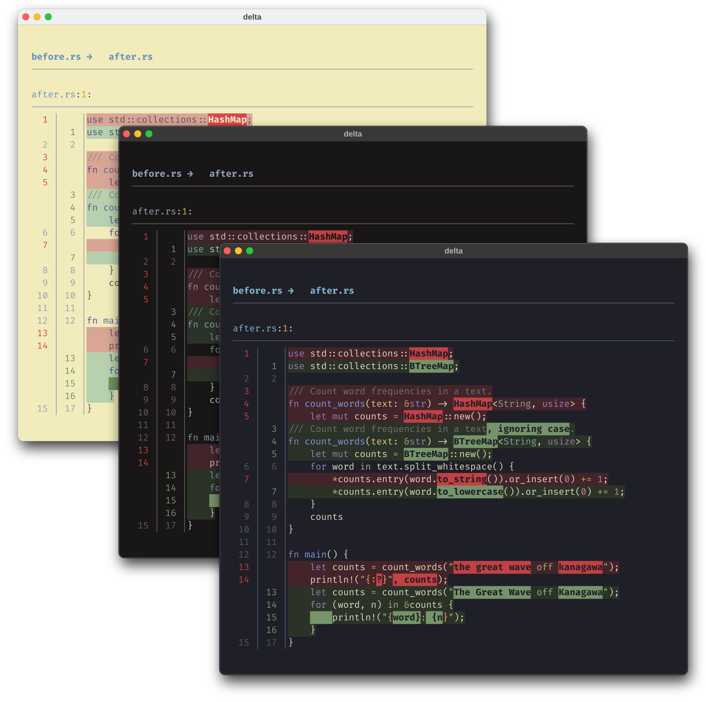
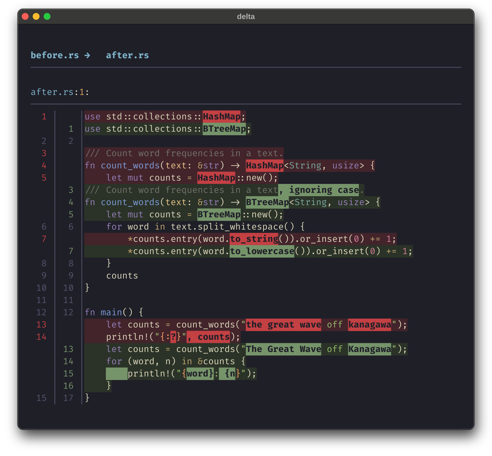
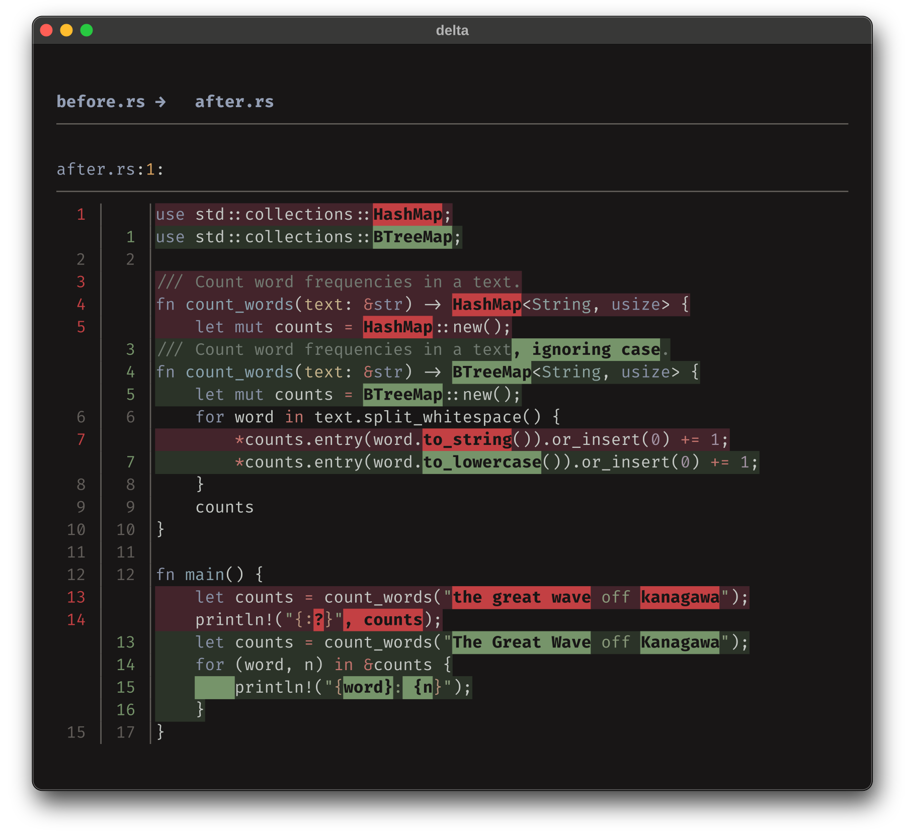
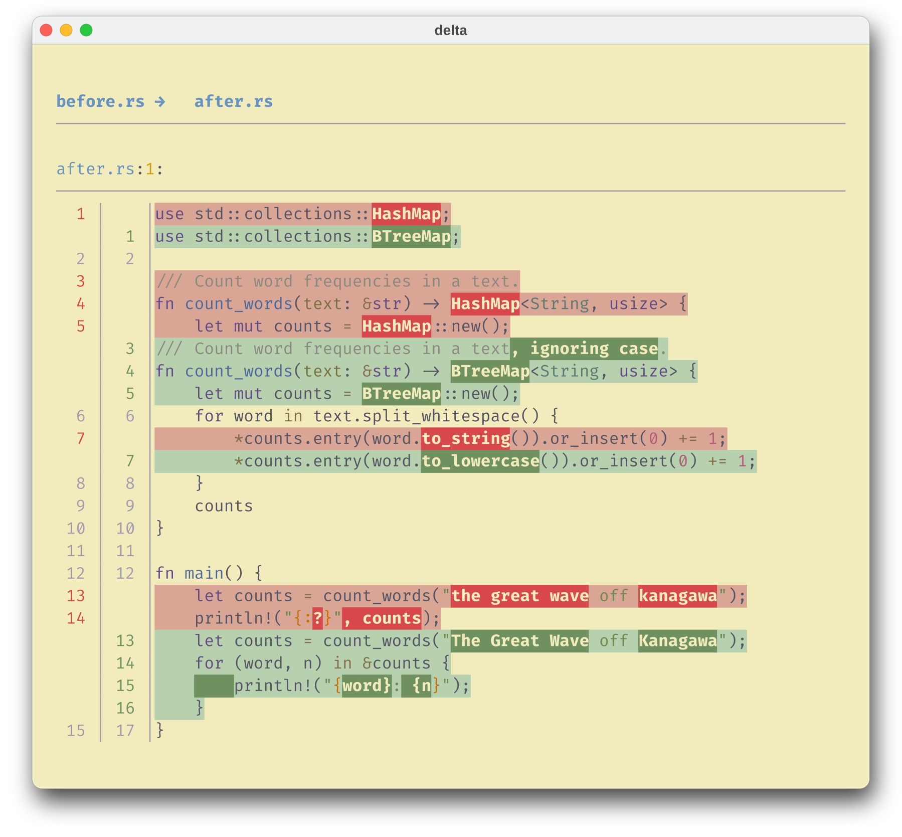

<h3>Kanagawa for <a href="https://github.com/dandavison/delta">delta</a></h3>
<p>A community-maintained theme inspired by Hokusai's <em>The Great Wave off Kanagawa</em>.</p>
<p>Using the <a href="https://github.com/rebelot/kanagawa.nvim">Kanagawa palette</a> by <a href="https://github.com/rebelot">Tommaso Laurenzi (rebelot)</a>.</p>

<p>
  <a href="https://github.com/kanagawa-community/delta/stargazers">
    <picture>
      <source media="(prefers-color-scheme: dark)" srcset="https://img.shields.io/github/stars/kanagawa-community/delta?style=for-the-badge&amp;labelColor=1F1F28&amp;color=E6C384">
      <source media="(prefers-color-scheme: light)" srcset="https://img.shields.io/github/stars/kanagawa-community/delta?style=for-the-badge&amp;labelColor=F2ECBC&amp;color=77713F">
      
    </picture>
  </a>
  <a href="https://github.com/kanagawa-community/delta/releases/latest">
    <picture>
      <source media="(prefers-color-scheme: dark)" srcset="https://img.shields.io/github/v/release/kanagawa-community/delta?style=for-the-badge&amp;label=release&amp;labelColor=1F1F28&amp;color=7E9CD8">
      <source media="(prefers-color-scheme: light)" srcset="https://img.shields.io/github/v/release/kanagawa-community/delta?style=for-the-badge&amp;label=release&amp;labelColor=F2ECBC&amp;color=4D699B">
      
    </picture>
  </a>
  <a href="https://github.com/kanagawa-community/delta/issues">
    <picture>
      <source media="(prefers-color-scheme: dark)" srcset="https://img.shields.io/github/issues/kanagawa-community/delta?style=for-the-badge&amp;labelColor=1F1F28&amp;color=C34043">
      <source media="(prefers-color-scheme: light)" srcset="https://img.shields.io/github/issues/kanagawa-community/delta?style=for-the-badge&amp;labelColor=F2ECBC&amp;color=C84053">
      
    </picture>
  </a>
</p>

<br clear="both">
<br>

## Previews



<details>
<summary>🌊 Wave</summary>

</details>

<details>
<summary>🐉 Dragon</summary>

</details>

<details>
<summary>🪷 Lotus</summary>

</details>

## Requirements

- [delta](https://github.com/dandavison/delta) 0.18 or later (for `blame-palette` and `map-styles`)
- [bat](https://github.com/sharkdp/bat), to load the syntax themes

## Installation

Clone the repository and install the syntax themes into bat, which delta reads:

```sh
git clone https://github.com/kanagawa-community/delta
mkdir -p "$(bat --config-dir)/themes"
cp delta/themes/bat/*.tmTheme "$(bat --config-dir)/themes/"
bat cache --build
```

Copy the `themes/*.gitconfig` files somewhere stable, for example
`~/.config/delta/`:

```sh
mkdir -p ~/.config/delta
cp delta/themes/*.gitconfig ~/.config/delta/
```

The `.tmTheme` files are bundled here until the Kanagawa bat port exists.

## Usage

Include the variant file in `~/.gitconfig` and enable its feature:

```ini
[include]
    path = ~/.config/delta/kanagawa-wave.gitconfig

[core]
    pager = delta

[interactive]
    diffFilter = delta --color-only

[delta]
    features = kanagawa-wave
```

Moved lines get a faint background when git detects them. Turn detection on
with `[diff] colorMoved = default`; the feature maps git's moved colors with
delta's [`map-styles`](https://dandavison.github.io/delta/color-moved-support.html).

For Dragon or Lotus include `kanagawa-dragon.gitconfig` or
`kanagawa-lotus.gitconfig` and use `kanagawa-dragon` or `kanagawa-lotus`. Check the result
with `delta --show-config` and `delta --list-syntax-themes`.

## Issues and contributions

Report bugs and request changes in this port's
[issue tracker](https://github.com/kanagawa-community/delta/issues). Contributions are welcome.

See [CONTRIBUTING.md](CONTRIBUTING.md) before opening a pull request.

## License

MIT. See [LICENSE](LICENSE).
